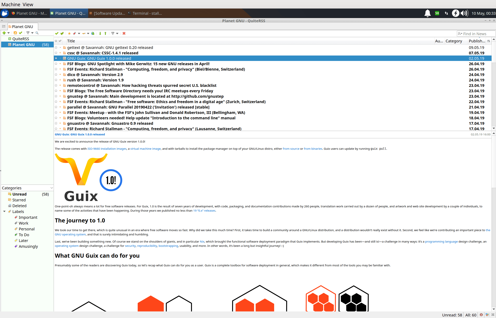
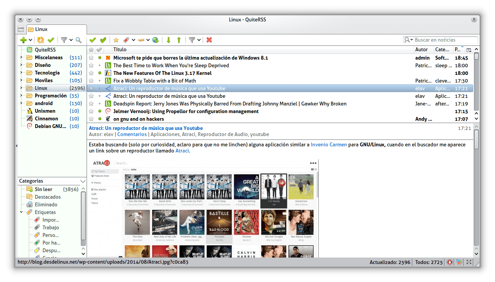

# QuiteRSS Cross Platform Feed Reader

QuiteRSS is a C++ and Qt desktop reader for RSS and Atom feeds.
It combines feed organization, article search, a built-in browser, and notification controls.

[](https://github.com/quiterss-rss-reader/quiterss/releases/)

## Objectives

QuiteRSS keeps subscribed feeds and article review in one desktop workspace.
It supports a traditional three-panel layout as well as a newspaper-style presentation.

The project provides Windows, Linux, macOS, and OS/2 builds.
A portable package can run without a conventional installation.

## Feature Overview

| Reading need | QuiteRSS capability | Practical result |
| --- | --- | --- |
| Follow publications | RSS and Atom feeds | Collect updates in one reader |
| Browse articles | Classic and newspaper layouts | Choose a compact or spacious view |
| Read linked content | Built-in browser | Open pages within the application |
| Organize sources | Folder hierarchies | Group feeds by subject |
| Mark important items | Stars, tags, and labels | Keep a review queue |
| Find past entries | Search and feed filters | Narrow the article list |
| Import subscriptions | OPML support | Move an existing feed collection |
| Notice new items | Tray counters and alerts | See updates without constant checking |



## Feed Workspace

The QuiteRSS RSS reader presents feeds, posts, and a browser view in a classic layout.
Newspaper mode offers a different way to scan article summaries and headlines.

Keep the feed tree organized around subjects you actually revisit.
Folder names should describe a reading purpose rather than a temporary task.

### A Reading Cycle

1. Refresh the selected feeds.
2. Scan unread headlines.
3. Open an article in the reader or built-in browser.
4. Star or label items that need another pass.
5. Mark completed entries as read.

This workflow separates collection from review.
It does not guarantee that every publisher provides a full article body.

### Folder Organization

Use nested folders for broad subjects and subtopics.
Drag-and-drop sorting can help maintain a deliberate order as the collection grows.

Avoid putting every feed in one large folder.
A smaller number of meaningful groups makes the reader easier to scan.

## Layouts and Article Views

The classic layout keeps the feed list, post list, and browser area visible together.
Newspaper mode emphasizes a stream of article summaries.

| Mode | Useful for | Trade-off |
| --- | --- | --- |
| Classic | Choosing one feed and reading its entries | More panels share the window |
| Newspaper | Scanning many headlines | Less space for source navigation |
| Browser view | Following an article page | Depends on page compatibility |
| Filtered list | Reviewing a saved criterion | Requires a carefully chosen filter |



## Search and Filters

Search filters help locate articles by their available text and metadata.
Use a distinctive phrase, author, title, or source name when looking for a known entry.

Before applying a broad filter:

- Confirm the selected feed or folder.
- Check whether read and unread entries are included.
- Use a narrow phrase first.
- Review several results.
- Clear the filter after the task is complete.

A filter changes the visible list.
It does not delete entries that are hidden by the current view.

## Tags, Stars, and Labels

Stars identify items worth revisiting.
Tags and custom labels can express a more specific review state.

A simple scheme might use labels for:

- Read later.
- Research.
- Follow-up.
- Reference.
- Shared.

Keep labels stable across folders.
Changing a label's meaning makes the saved reading queue harder to trust.

## Import and Portable Data

OPML import and export help transfer feed subscriptions between readers.
An OPML file describes feeds and folders, not necessarily article history or downloaded pages.

Keep an exported OPML file with a date in its filename.
Open it as text before importing if you need to review the feed addresses.

The portable build can keep the reader's data beside its application files.
Portable media should still be backed up and protected from unauthorized access.

## Notifications

QuiteRSS can use system tray integration, unread counters, desktop alerts, and sound notifications.
Notifications are useful for attention management but should not replace a regular feed review.

Use quieter notification settings for high-volume feeds.
Reserve sounds or persistent alerts for sources that need prompt attention.

## Built-In Browser and Media

QuiteRSS includes a browser view for following linked pages.
The repository also contains HTML templates for news, audio, video, and newspaper presentation.

The browser view depends on the embedded web component and the page itself.
A feed entry may be readable even when its linked page is not.

Local presentation resources include [news.html](html/news.html), [newspaper_head.html](html/newspaper_head.html), and [audioplayer.html](html/audioplayer.html).
Video presentation is represented by [videoplayer.html](html/videoplayer.html).

## Appearance and Themes

The interface includes Qt style sheets for different visual choices.
Examples include dark.qss, gray.qss, green.qss, and purple.qss.

Additional style resources include pink.qss, orange.qss, system.qss, and system2.qss.
Keep a customized style separate so it can be compared with the original theme.

## Build Requirements

The source build uses Qt, qmake, and a C++ compiler.
The project documentation lists SQLite, Qt SQL support, Qt WebKit, Qt XML, and Qt tools as required parts of the build environment.

| Component | Role |
| --- | --- |
| GCC or Clang | Compile the application |
| SQLite 3.30.1 or newer | Store reader data |
| Qt 4.7, Qt 4.8, or Qt 5.4 | Application framework in the documented build |
| qmake | Generate build files |
| lrelease | Build translation resources |
| Qt WebKit and Qt XML | Browser and document features |

Check the source's current requirements before selecting a Qt version.
Older project instructions may not describe every modern distribution package.

## Build from Source

The project uses a qmake-based workflow.
The following example follows the Unix-like build instructions.

```bash
mkdir _build
cd _build
qmake CONFIG+=release PREFIX=/usr ../QuiteRSS.pro
make -j3
```

The project file is [QuiteRSS.pro](QuiteRSS.pro).
Build metadata and VCS revision handling are defined in that project configuration.

### Resources and Packaging

The Qt resource collection is declared in [QuiteRSS.qrc](QuiteRSS.qrc).
Platform packaging files include [QuiteRSSApp.rc](QuiteRSSApp.rc), [quiterss_os2.rc](quiterss_os2.rc), Info.plist, and quiterss.desktop.

The installation notes are kept in [INSTALL](INSTALL).
Review the intended prefix and package layout before copying a build into a system directory.

## Release Line

The latest stable QuiteRSS release is 0.19.4.
The release is available for the project platforms, including portable distribution options.

Review [CHANGELOG](CHANGELOG) before replacing an existing profile.
Keep a backup of the reader data and an OPML export before testing a new package.

## Contributing

Useful reports include the reader version, operating system, feed format, selected layout, and reproducible steps.
When sharing a feed example, remove private URLs and credentials.

Keep changes focused when modifying styles, HTML resources, or build files.
Test both the feed list and article view when a resource affects presentation.

## Related Search Terms

quiterss rss reader, quiterss feed reader, quiterss open source, quiterss portable, quiterss linux, rss, atom, feed-reader, qt, c-plus-plus, opml, newspaper-mode, ad-blocking, desktop, notifications
